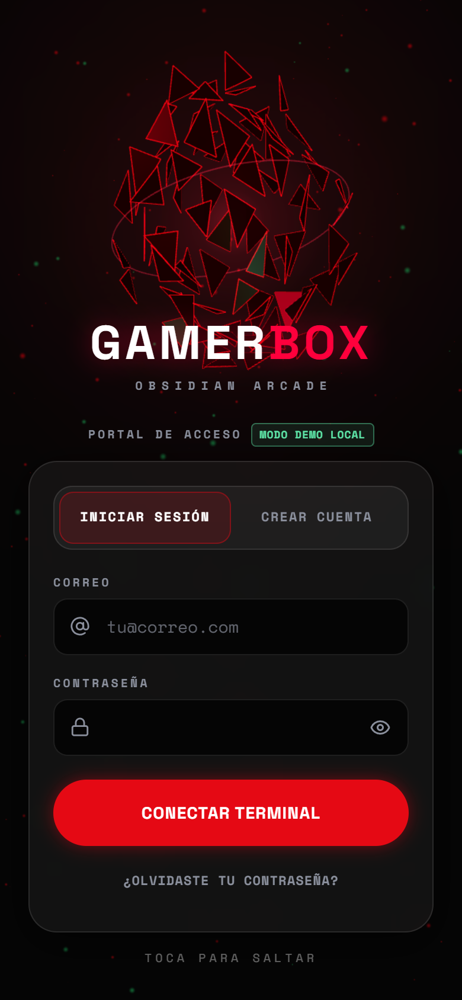

# GamerBox — Obsidian Arcade

A social, tactical game tracker for Android. Keep your backlog in **La Bóveda**, find the next game with
global search, Steam deals and **the Oracle**, post reviews, build a squad, and level up with XP and platinums.

Built with Next.js 14 (static export) wrapped as a native Android app with Capacitor 8.



## Features

- **Cinematic 3D intro** — procedural three.js "Obsidian Core": data motes condense into a faceted obsidian crystal,
  it cracks, the wordmark glitches in and the login rises. ~3.6 s, once per cold start, tap or hardware back to skip,
  toggle in *Settings → Startup animation*. CSS/SVG fallback for no-WebGL or slow GPUs, 600 ms fade for reduced motion.
- **Login** — compact live crystal that reacts to focus/typing/errors (never to password length), inline validation,
  show/hide password, password reset email, Gamertag rules, ES/EN.
- **First-run tutorial** — 4-slide welcome + 7-step spotlight tour over the real UI. Once per account, replayable
  from Settings and Profile, works with the hardware back button.
- **Vault** — statuses, hours, progress, favorites, filters built from your own library.
- **Discover** — global search (CheapShark), live Steam deals, the Oracle (Gemini) with local-catalog fallback.
- **Community** — reviews, likes, comments, squad search by exact Gamertag.
- **Profile** — XP / levels (1,000 XP per level), platinums, genre distribution, editable avatar.
- Dark and light themes, Spanish and English (`src/i18n/dictionary.ts`, checked by `npm run i18n:check`).

## Run

```bash
npm install
cp .env.example .env.local   # fill in Firebase (+ optional Gemini)
npm run dev                  # http://localhost:3000
```

Without Firebase variables the app runs in **local demo mode** (accounts live on the device only; marked in the login).

Checks: `npm run lint`, `npm run typecheck`, `npm run i18n:check`, `npm run build`.

## Build the APK

Requirements: Android SDK (36), **JDK 17 or 21** (Gradle 8.14 does not run on JDK 25).

```bash
npm run build
npx cap sync android
cd android
./gradlew assembleDebug     # app/build/outputs/apk/debug/app-debug.apk
./gradlew assembleRelease   # app/build/outputs/apk/release/app-release.apk (signed if keystore.properties exists)
```

Release signing reads `android/keystore.properties` (not in git):

```
storeFile=gamerbox-release.jks
storePassword=…
keyAlias=gamerbox
keyPassword=…
```

**Back up `android/gamerbox-release.jks` and `android/keystore.properties`.** Losing them means future updates
cannot be installed over this version.

## Install on a phone

1. Copy `dist-apk/GamerBox-1.0.0-release.apk` to the phone (or `adb install -r <apk>`).
2. Allow *Install unknown apps* for the file manager/browser you open it with.
3. Open the APK and install. If an older debug build is installed, uninstall it first (different signature).

## Environment variables

See `.env.example`. All `NEXT_PUBLIC_*` values are inlined into the JavaScript bundle and can be extracted from the APK.

## Firebase setup

1. Firebase console → Authentication → enable **Email/Password**.
2. Firestore → create the database.
3. Deploy the rules in this repo (not deployed automatically):
   ```bash
   firebase deploy --only firestore:rules
   ```
   `firestore.rules`: a user's vault is private to that user; `public_profiles` exposes only gamertag/title/stats for squad
   search; community posts are readable by signed-in users, created only as yourself, others may only like/comment,
   delete only by the author.

## Security notes

- No password, hash or token is stored in localStorage. Older builds stored plaintext passwords in
  `gamerbox_accounts_vault`; the app strips them on first launch and keeps only uid/email/name/avatar for the
  "saved accounts on this device" quick-fill.
- The previous "Continue with Google" button was a simulation (it created an account from a typed email). It was
  removed. Real Google sign-in would need `@capacitor-firebase/authentication`, the Google provider enabled,
  SHA-1/SHA-256 fingerprints of the signing key added in Firebase, and `android/app/google-services.json`.
- **Gemini key exposure:** `NEXT_PUBLIC_GEMINI_API_KEY` ships inside the APK. Use a low-quota key restricted to the
  Generative Language API, and **rotate it after the exhibition**. Without a key the Oracle answers from the built-in
  catalog with no error UI. Model defaults to `gemini-flash-latest` (override with `NEXT_PUBLIC_GEMINI_MODEL`).
- Android: release is not debuggable, `allowBackup=false`, cleartext traffic off, only `INTERNET` permission.

## Demo script (6 steps)

1. **Intro** — open the app: boot lines, crystal forms, cracks, wordmark glitch, login rises (tap to skip).
2. **Login** — create an account (Gamertag + email + password); show a validation error, then the crystal burst.
3. **Tutorial** — swipe the 4 slides, follow the spotlight tour (nav, add game, Oracle, vault, review, XP, settings).
4. **Add a game** — Discover → *Register a game*, type "Elden", pick the match, save; open it, set *Playing*, log 2 h.
5. **Oracle / deals** — *Ask the Oracle*, add a pick; *Get advice* on Steam deals.
6. **Community & profile** — post a review, like it, add `NeonDrifter` to the squad; Profile shows XP/level;
   Settings → switch to Light and English.

## Credits

See [CREDITS.md](CREDITS.md).
